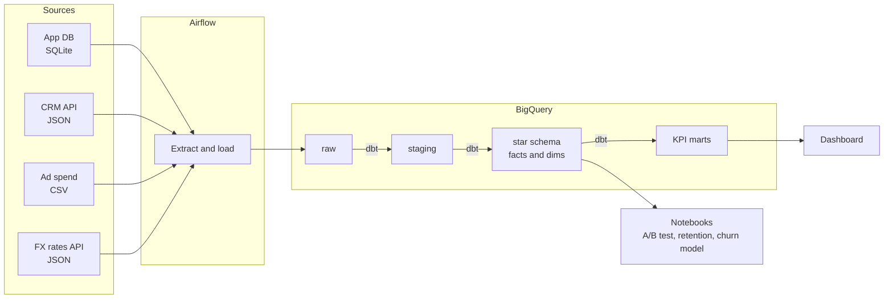

# Business Metrics Tracking: one source of truth for leadership KPIs

Leadership at PulseBoard, a fictional B2B SaaS company, tracks its metrics in Excel, and the numbers
never match across teams. Product counts QA staff and duplicated mobile events as "active users", sales
reports revenue by whatever segment a rep typed into the CRM, and finance adds up invoices in five
currencies.

This project builds the end-to-end data flow that fixes that: **extract** from four sources, **model** a
governed star schema in BigQuery with dbt, **orchestrate** it with Airflow, and **serve** one set of
trusted KPIs to a dashboard. On top of the warehouse sit the analyses a data scientist would be asked
for: an A/B test readout, cohort retention, and a churn model.

> All data is synthetic, generated by `data_generator/` with a fixed seed. It is designed to behave like
> a real company's data: seasonality, an outage, a logging bug, messy CRM entries, multi-currency billing,
> and a hidden churn signal.

## Architecture



## KPIs

Every KPI has one written definition in the [metrics spec](docs/metrics_spec.md).

| KPI | Definition, in short |
|---|---|
| Daily Active Users | Distinct non-internal users with a qualifying event on a UTC date |
| Revenue by segment | MRR in USD by CRM segment, with new, expansion, contraction and churn movements |
| Funnel conversion | Signup, onboarded, activated, trial, paid, by signup cohort and within fixed windows |
| Retention | Weekly user cohort retention; logo, gross and net revenue retention |

## Roadmap

| Step | What | Status |
|---|---|---|
| 1 | Synthetic data generator, [data source docs](docs/data_sources.md), [metrics spec](docs/metrics_spec.md) | Done |
| 2 | Load to BigQuery, Airflow DAG | Planned |
| 3 | dbt: staging, star schema, KPI marts, tests | Planned |
| 4 | Notebooks (A/B test, retention, churn model), dashboard | Planned |

## Quick start

```bash
pip install -r requirements.txt
make data     # full dataset into data/raw (about 20 seconds, about 170 MB)
make test
```

`make data-small` builds a 500-account version for quick iteration.

## Repository layout

```
data_generator/   simulation of the business and writers for each source format
docs/             data source reference and the metrics spec
tests/            generator tests: integrity, ordering, planted data issues
```
