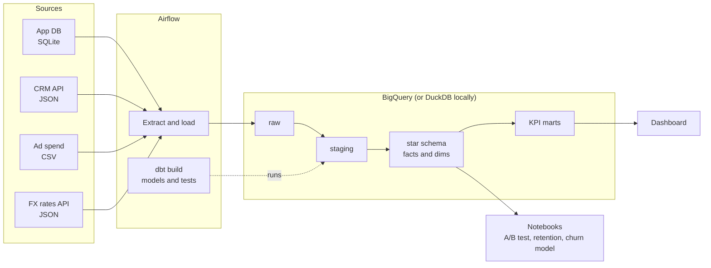

# Business Metrics Tracking: one source of truth for leadership KPIs

Leadership at PulseBoard, a fictional B2B SaaS company, tracks its metrics in Excel, and the numbers
never match across teams. Product counts QA staff and duplicated mobile events as "active users", sales
reports revenue by whatever segment a rep typed into the CRM, and finance adds up invoices in five
currencies.

This project builds the end-to-end data flow that fixes that: **extract** from four sources, **model** a
governed star schema in BigQuery with dbt, **orchestrate** it with Airflow, and **serve** one set of
trusted KPIs to a dashboard. On top of the warehouse sit the analyses a data scientist would be asked
for: an A/B test readout, cohort retention, and a churn model.

**[Open the live dashboard (Looker Studio)](https://lookerstudio.google.com/reporting/42cee920-d8f4-443e-b7e3-b1d6b169e090)**, built on the BigQuery warehouse this pipeline produces.

> All data is synthetic, generated by `data_generator/` with a fixed seed. It is designed to behave like
> a real company's data: seasonality, an outage, a logging bug, messy CRM entries, multi-currency billing,
> and a hidden churn signal.

## Architecture



## KPIs

Every KPI has one written definition in the [metrics spec](docs/metrics_spec.md).

| KPI | Definition, in short |
|---|---|
| Daily Active Users | Distinct non-internal users with a qualifying event on a UTC date |
| Revenue by segment | MRR in USD by CRM segment, with new, expansion, contraction and churn movements |
| Funnel conversion | Signup, onboarded, activated, trial, paid, by signup cohort and within fixed windows |
| Retention | Weekly user cohort retention; logo, gross and net revenue retention |

## Roadmap

| Step | What | Status |
|---|---|---|
| 1 | Synthetic data generator, [data source docs](docs/data_sources.md), [metrics spec](docs/metrics_spec.md) | Done |
| 2 | Load to BigQuery, Airflow DAG, [setup guide](docs/setup.md) | Done |
| 3 | dbt: staging, star schema, KPI marts, about 100 tests ([warehouse model](docs/warehouse_model.md)) | Done |
| 4 | [Notebooks](notebooks/) (A/B test, retention, churn model) and the [dashboard](dashboard/) for Power BI and Looker Studio | Done |
| 5 | Run on BigQuery with Airflow; [live Looker Studio report](https://lookerstudio.google.com/reporting/42cee920-d8f4-443e-b7e3-b1d6b169e090) | Done |

## Findings

| | |
|---|---|
| **Onboarding A/B test** | The guided checklist raised activation from 41% to 51% (p < 0.001). Revenue impact can't be measured at this sample size, and the analysis says so. [Notebook](notebooks/01_onboarding_ab_test.ipynb) |
| **Retention** | Owners who don't activate in week 1 almost never come back. Enterprise net revenue retention is 104%, SMB 82%. [Notebook](notebooks/02_retention.ipynb) |
| **Churn risk** | A point-in-time model ranks accounts with ROC AUC 0.80. The riskiest 10% hold about 40% of next-60-day churners, and the scores feed the dashboard. [Notebook](notebooks/03_churn_model.ipynb) |

## Highlights

- **One definition per metric**, written down in the [metrics spec](docs/metrics_spec.md) and enforced in
  dbt tests. For example, MRR movements must reconcile to the change in MRR every month, and a new CRM
  segment spelling fails the build until someone maps it.
- **Seventeen real-world data problems handled on purpose**: duplicate and late events, internal users,
  inconsistent CRM entries, overlapping exports, five currencies, weekend FX gaps
  ([list](docs/data_sources.md#known-data-quality-issues)).
- **Runs anywhere.** The same dbt models build on BigQuery and on a local DuckDB file, so CI runs the
  whole pipeline on every push without cloud credentials.
- **Orchestrated in Airflow 3**: a daily, incremental, idempotent DAG that backfills itself on first run.
- **Data science on governed data.** The notebooks read the same tables as the dashboard, and a test
  proves the churn features never use information from after the prediction date.

## Quick start

No cloud account needed:

```bash
pip install -r requirements.txt -r docker/requirements-dbt.txt
make data        # generate the four sources (about 20 seconds)
make warehouse   # load them into a local DuckDB warehouse
make dbt         # build the models and run the tests
make test        # Python tests
```

For BigQuery and Airflow, follow the [setup guide](docs/setup.md).

## Repository layout

```
data_generator/   simulation of the business and writers for each source format
ingestion/        extractors for each source and loaders for BigQuery (or local NDJSON)
transform/        dbt project: staging, intermediate, core (star schema) and metrics models
notebooks/        A/B test analysis, retention and survival, churn model
analysis/         notebook helpers: warehouse access, churn features, CSV export
dashboard/        dashboard spec, Power BI guide, DAX measures, theme, Looker Studio guide
dags/             Airflow DAG: generate sources, load raw tables, check them, dbt build
docker/           Airflow image (Airflow 3.2, BigQuery client, dbt in its own virtualenv)
docs/             setup guide, data sources, warehouse model and the metrics spec
tests/            generator, ingestion and DAG tests
```
