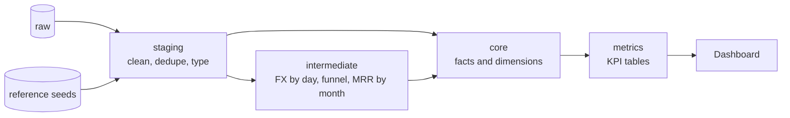
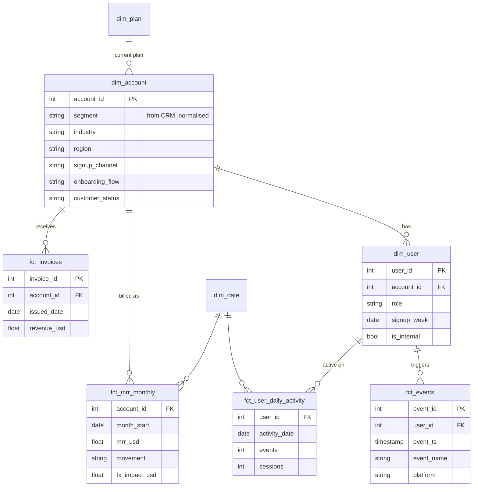

# Warehouse model

The dbt project in `transform/` turns raw source tables into one governed star schema, and then into
KPI tables the dashboard reads directly. It runs unchanged on BigQuery (production) and DuckDB (local
and CI); the few dialect differences live in `transform/macros/cross_db.sql`.

## Layers

| Layer | Materialised as | Rule |
|---|---|---|
| staging | views (events: table) | One model per source table. Rename, cast, deduplicate, flag. No joins except reference seeds. |
| intermediate | views | Reusable building blocks that aren't meant for end users. |
| core | tables | The star schema. Every metric is computed from here. |
| metrics | tables | One table per KPI family, additive where possible, documented in the [metrics spec](metrics_spec.md). |

## Star schema

`fct_ad_spend_daily` (date, platform, campaign, channel, spend) sits beside these and joins to accounts
through the signup channel.

## KPI tables

| Table | Grain | Feeds |
|---|---|---|
| `kpi_daily_active_users` | date x segment | DAU, WAU, MAU, stickiness |
| `kpi_revenue_by_segment` | month x segment | MRR, MRR movements, billed revenue, ARPA |
| `kpi_revenue_retention` | month x segment | Logo retention, GRR, NRR |
| `kpi_funnel_by_cohort` | signup week x segment x channel x onboarding flow | Funnel conversion |
| `kpi_user_retention_cohorts` | signup week x segment x week number | Cohort retention curves |
| `kpi_acquisition_monthly` | month x channel | Signups, conversion, spend, CAC |
| `kpi_onboarding_experiment` | variant | A/B test summary |

## Tests

`dbt build` runs about 100 tests on every run, and any failure fails the Airflow run.

- **Keys**: unique and not null on every primary key, unique combinations on every fact grain.
- **Relationships**: users to accounts, events to users, subscriptions to plans.
- **Accepted values**: segments, event names, currencies, invoice statuses, MRR movements.
- **Business rules**: MRR movements reconcile to the change in MRR; funnel counts never increase down
  the funnel; DAU <= WAU <= MAU; GRR is at most 100% and never above NRR.
- **Governance**: every CRM segment spelling must be mapped in `seeds/segment_mapping.csv`; every
  invoice must convert to USD.
- **Unit test**: MRR movement classification, including an exchange-rate move that must not look like
  contraction.
- **Warning**: sessions with repeated `session_start` events, which flags client tracking bugs such as
  the January 2026 iOS double-fire.
